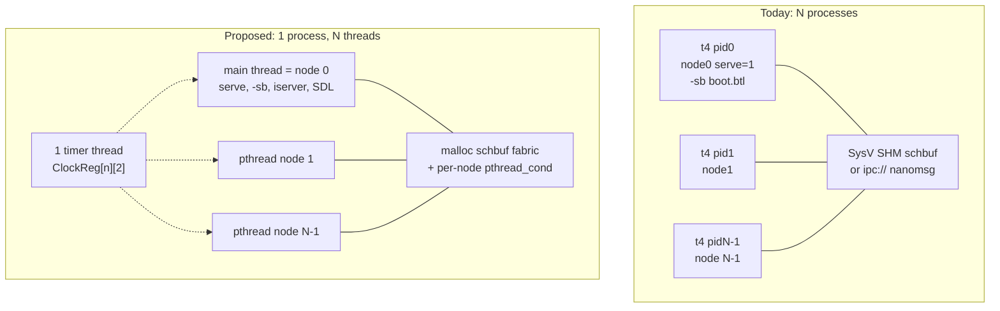
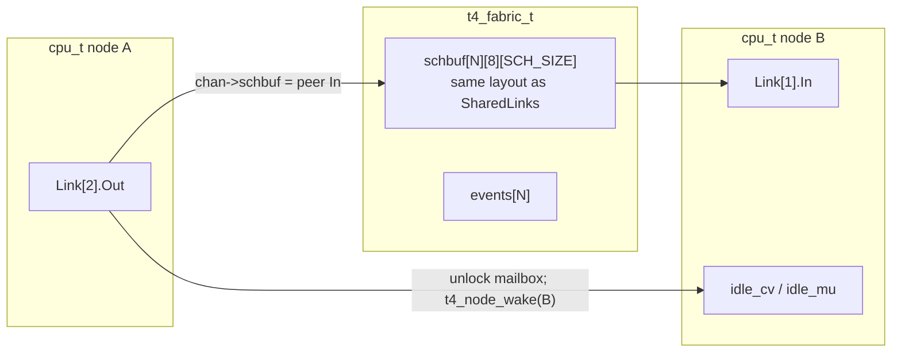
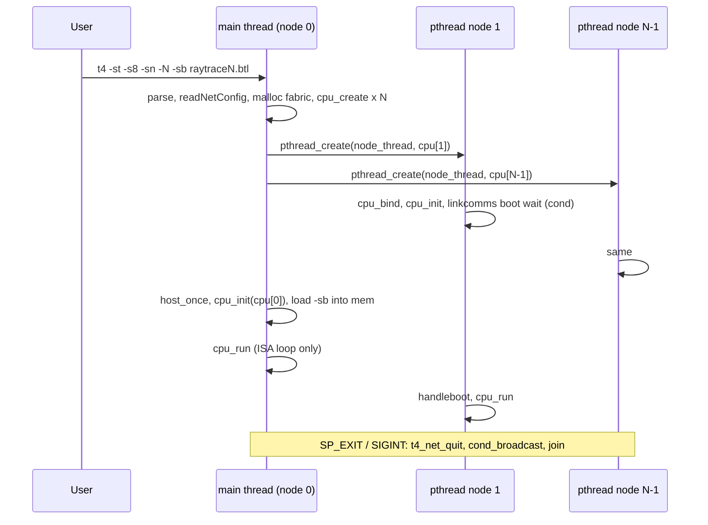

# One Thread per T4 Emulator Node (In-Process Multi-Transputer)

| Field | Value |
|-------|-------|
| **Author** | t4 emulator work (draft) |
| **Date** | 2026-08-19 |
| **Status** | Reviewed (2026-08-19) |
| **Scope** | Host scheduling only. No ISA/RTL changes. |
| **Primary code** | `transputer/t4/{p.c,main.c,shlink.c,netcfg.c,server.c,timer_integration.c}` |
| **Correctness oracle** | `examples/transputer-raytracer/bin/testall.sh`; `pic/rayM.ppm` byte-identical |

---

## Overview

The T4 emulator can already run an N-transputer network, but each node is a separate OS process. CPU state (`IPtr`, `WPtr`, `AReg`/`BReg`/`CReg`, `mem`, `Icache`, `Link[4]`, …) is process-global, so two nodes cannot coexist in one address space. Shared-memory links (`-sl`) use SysV SHM with a create/attach race and a usleep idle poll; `ipc://` (nanomsg) is what made N=8..80 pass. The user asked whether each T4 can instead be a thread.

This document specifies that refactor: **one OS thread per emulated transputer, inside one process**. It is a host-scheduling change, not “threading the ISA.” `T4_PERF.md` remains in force: a single executor owns each node’s guest state; background threads stay limited to timer / SDL / TAP / UART. Process mode (`-sl` and `ipc://`) stays the default and must keep working until threaded mode matches the raytracer oracle.

The proposed shape is: wrap per-node state in a `cpu_t`, keep the 11k-line `p.c` hot path looking like `IPtr`/`WPtr` via macros over a TLS `cpu_t *`, replace in-process links with the existing `schbuf` packet layout in anonymous memory, block **only** in the idle/boot path that currently `usleep`s (`pthread_cond_timedwait` on `CLOCK_MONOTONIC`), and spawn worker nodes with `pthread_create` instead of `fork`/`exec` when `-st` is set. `channel_sendP` / `channel_recvP` stay non-blocking (EAGAIN + deschedule). `mainloop()` is split so workers do not start extra timer threads or pump SDL.

---

## Background & Motivation

### Current multi-node model

A network is N independent `t4` processes sharing a map file (`SPYNET` or `<boot>.map`, parsed by `readNetConfig()` in `netcfg.c`).

Two ways to start it:

1. **Manual / `testall.sh`.** For N>1, the script starts workers then node 0:

   ```text
   t4 -s8 -sl -sn 1          # node 1 FIRST when using -sl
   t4 -s8 -sl -sn 2 … N-1
   t4 -s8 -sl -sn 0 -sb raytraceN.btl
   ```

   Without `-sl`, links are nanomsg `ipc:///tmp/node%d-%d.lnk` (`netLinkURL()`).

2. **Supervisor spawn.** `t4 -sn -N` (negative node id) in `main.c` (~560–570, 814–846):

   ```c
   nxputers = -nodeid;   /* N */
   nodeid   = 0;
   shlinks  = TRUE;      /* always -sl */
   /* then SpawnVP("t4", {"t4","-sl","-sn","i", "-s8", NULL}) for i=1..N-1 */
   ```

   Linux `SpawnVP` is `fork`+`execvp`. Children are extra processes; `testall.sh` does not use this path because it cannot clean them up.

### Link transports today

| Transport | Who creates | Packet | Idle | Constraint |
|-----------|-------------|--------|------|------------|
| `-sl` SysV SHM | Node 1 (`open_channel()`, `p.c` ~3033: `(1 == nodeid) \|\| (0 == maxnode)` → `shlink_alloc(NetConfigName, …)`, others `shlink_attach`) | One packet per channel in `schbuf[SCH_SIZE]`; `SCH_SIZE = MAX_DATA+SCH_DATA = 1024` | `usleep` slices, `LTO_IDLE=5` ms, `SCH_POLL_IDLE=1000` µs | Node 1 must exist first; `ftok(mapfile, 1984)`; leftover segment poisons the next run (`"SHMLinks already exists"`) |
| `ipc://` nanomsg | Each node `nn_bind`s its In, `nn_connect`s its Out | `nn_send`/`nn_recv` | `nn_poll` | No start-order constraint. Needs `-DT4NANOMSG` (Makefile.linux pkg-config). This is what passed N=8..80 |

Layout of SHM (`open_channel()` ~3024–3065):

```text
SharedLinks:  [node 0][node 1]…[node max]   each node = 8 * SCH_SIZE
              In0 In1 In2 In3 Out0 Out1 Out2 Out3   (Out.schbuf actually points at peer In)
SharedEvents: SharedLinks + 8*SCH_SIZE*(1+maxnode)   /* SHLINK_EXTRA = 1024 bytes */
```

`channel_sendP` / `channel_recvP` already speak both transports: if `chan->schbuf` is non-NULL they memcpy + `SCHLength(chan)`, else they call nanomsg.

### Why a thread per node is in scope, and threading the ISA is not

`T4_PERF.md` rule 1: **“Single executor for guest state (IPtr/WPtr/A/B/C/mem). Never thread the ISA.”** Background threads are already used for the wall-clock timer (`timer_integration.c`, C11 `thrd_create`, 100 µs poll, updates `_Atomic ClockReg[2]` and `timeslice`).

One thread per *node* preserves that rule: each thread is the unique mutator of that node’s registers and RAM. Splitting one node across threads (e.g. a decode thread plus an execute thread sharing `IPtr`) is out of scope and forbidden.

### Pain points this refactor addresses

- **Process tax.** N=80 is 80 address spaces, 80 timer threads, 80 copies of the 11k-line text, 80 SysV/ipc objects. Oversubscribe on 10 cores is already the `testall.sh` warning.
- **SHM operational hazards.** `testall.sh` is mostly a SHM janitor: `ftok` reconstruction, `ipcrm`, wait-for-detach, start-node-1-first. Futex-on-SharedWake was tried and reverted (N=8 SHM hung, 0 R patch) — that was a *cross-process* futex on SysV memory, not an in-process private wait.
- **Idle poll.** `linkcomms()` on schbuf busy-waits in 1 ms `usleep` slices (`p.c` ~2815–2842). `npfd==0` now sleeps `timeOut` ms and returns 1 (not instant deadlock). That is correct but still wakes 80 idle workers every few milliseconds.
- **`t4 -sn -N` always forces `-sl`.** There is no in-process option.

### Recent fixes this design must not re-litigate

Cite and keep:

1. **Link0In read shim** (`word_int()`, `p.c` ~10253–10272). `mmio_iserver_read_byte()` is used only when `!serve && nodeid < 0`. Worker reads of `0x80000010` used to return 0, `schedule(0)`, wild-jump. Node 0 has `serve` set; workers have `nodeid >= 0`.
2. **Per-channel `CtrlByte`** (`Channel.CtrlByte` in `processor.h`; comment in `p.c` ~2392–2408). Was a file-scope global; a concurrent `handleboot()` left `WPtr=0`.
3. **Idle poll.** `LTO_IDLE=5` (`processor.h:82`), `SCH_POLL_IDLE=1000` (`p.c:2720`), `npfd==0` sleeps and returns 1 (`p.c` ~2793–2804).
4. **`schedule(IdleProcess_p)` ignored.** `schedule()` returns if `GetDescWPtr(wdesc) == NotProcess_p` (`p.c` ~9411–9413). `IdleProcess_p` is `NotProcess_p | LoPriority`.
5. **Futex-on-SharedWake reverted.** Do not resurrect cross-process futex on SHM.

### `emu_t` is not a substitute for this work

`emu.h` already groups `emu_cpu_t` / `emu_mem_t` / `emu_timer_t`, and `cpu.c` is a computed-goto scaffold. Neither is on the release hot path: `Makefile.linux` compiles `p.c` + `main.c` + …, not `cpu.c` / `mmio.c`. `REWRITE-PLAN.md` (2026-07-19) still lists Phase 1 as “Partial — `p.c` still owns the live global CPU state.” This design does not finish that rewrite. It gives `p.c` a per-node context so N copies can run.

---

## Goals & Non-Goals

### Goals

- Run N T4 nodes as N threads in one process, each with its own guest RAM and CPU state.
- Preserve ISA behaviour. The raytracer oracle (`pic/rayM.ppm` byte-identical) at arrangements 1,2,3,4,6,8,16,24,32,40,48,64,80 is the merge gate for enabling threaded mode as a recommended path.
- Keep process mode (`-sl`, `ipc://`, `t4 -sn -N` fork/exec) working, default, independently testable.
- Idle threads **block**, they do not spin. 80 threads on 10 cores must sleep in the kernel when waiting on a link or timer.
- Node 0 still owns iserver / `-sb` boot file / host link 0 (`serve`, `Link[0]` skipped in `linkcomms` when `serve`).
- Incremental PRs, each reviewable and mergeable.

### Non-Goals

- Threading a single node’s ISA (decode vs execute, concurrent `word_int` on one `mem`).
- Changing occam/config/BTL, the map file format, or the boot protocol (`handleboot` C_POKE/C_PEEK/C_BOOT).
- Replacing nanomsg for *cross-process* networks.
- Making `-sl` SysV SHM faster (leave it as-is; threaded mode is the in-process replacement).
- Windows/macOS threaded mode in the first landing (Makefiles exist; Linux is first).
- Finishing the `emu_t` / `cpu.c` rewrite, closing the remaining ~1.45× Dhrystone gap to the 2023 source (`T4_PERF.md`), or JIT.
- Per-node SDL windows, per-node TAP devices, or migrating a node between threads.

---

## Key Decisions

1. **`cpu_t` + TLS pointer + name macros, not a 668-site `cpu->IPtr` rewrite and not TLS of the whole state.** `p.c` is 11 708 lines with 668 `IPtr`, 303 `WPtr`, 656 `AReg` references. Putting the *object* in TLS would drag `Icache` (~256 KiB), `fast_blocks` (~3.3 MiB), and `mem*` into TLS segments. Putting only `cpu_t *t4cpu` in TLS, and `#define IPtr (t4cpu->IPtr)`, keeps the hot-path source and lets LTO CSE the pointer into a register. Explicit `cpu->` in every opcode is a later optional cleanup, not a prerequisite.

2. **In-process links reuse `schbuf`, in `malloc` (or `MAP_ANONYMOUS`), not nanomsg and not a new queue protocol.** `channel_sendP`/`channel_recvP` already implement the one-packet mailbox. `handleboot` C_PEEK today calls `nn_send` on `outchan->sock` (`p.c:2460–2465`) and must be routed through `channel_sendP` in the fabric PR — otherwise `-st` (and already `-sl`) cannot peek. `alt_channel` and the rest of `linkcomms` stay.

3. **`-st` is opt-in and stays explicit for at least one release.** Process mode remains default. `t4 -st -sn -N` spawns pthreads instead of `SpawnVP`. `t4 -sn -N` without `-st` still fork/execs `-sl` children and **must not** start implying threads after the raytracer oracle passes. `testall.sh --threads` passes the **CLI** flag (`-st`), not a sticky `T4_THREADS` export. `T4_THREADS=1` is accepted as an alias but is a **silent no-op** unless supervisor `-sn -N` is also present (standalone `-sb` stays one thread). `-st` + `-sl` or `-st` + non-negative `-sn` is still an error.

4. **Idle-only cond wait. `channel_sendP` / `channel_recvP` never block.** Today the schbuf path returns `EAGAIN` on a full/empty mailbox even when `doWait` is true (`p.c:2572–2595`, `2517–2529`); waiting lives in `linkcomms` / `start_process`. That split is load-bearing: a node with several guest processes must keep running the others while one is blocked on `chanout`. `linkcomms("running", …, LTO_COMM)` (`LTO_COMM=0`, `processor.h:83`) is a single non-blocking poll for exactly this reason. Cond wait replaces only the schbuf `usleep` loop when `timeOut > 0` (idle `LTO_IDLE=5` and boot `LTO_BOOT=1000`). **`linkcomms` must still walk `SCHLength` first and call `t4_node_idle_wait` only if nothing is ready** — a packet already in the mailbox has already bumped `idle_gen`; waiting for the next bump would burn `LTO_BOOT` (1 s) per hop. `t4_node_wake` locks the waiter’s `idle_mu` **after** dropping the mailbox lock; `idle_gen` lives in `t4_idle_t`. Both edges wake: send → receiver; recv/reset → sender. Cond is `CLOCK_MONOTONIC`. Not the reverted SharedWake futex. FUTEX_PRIVATE is a later Linux follow-up.

5. **Each node has its own `mem` of `MemSize`, plus a small pthread stack.** Default `-sm` omitted → `MemSize = 1 << 21` = 2 MiB (`p.c:199`). N=80 ≈ 160 MiB guest RAM. `pthread_create` uses `pthread_attr_setstacksize` (1 MiB; default glibc 8 MiB × 80 = 640 MiB VAS). Node 0 still owns SDL, TAP, iserver `Files[]`, and the boot FILE*.

6. **Signals and worker `exit()` land in the same PR that first creates threads.** Do not `handler(-1)` / `exit(2)` / `t4_signal_exit()` from a worker. `SP_EXIT` (`server.c:1471–1472`) and SIGINT/SIGTERM are process-wide (`t4_net_quit` + `cond_broadcast` + join + one `t4_signal_exit` on main). `display_backend_sdl.c` keeps a process-wide `quit`, not the per-node macro. `T4_THREADS_FAIL_FAST` default on: a worker halt (empty queues, WILDEXEC) shuts the farm — a dead worker hangs the raytracer otherwise.

7. **One process-wide timer thread. Keep today’s ClockReg vs timeslice split.** `timer_thread_fn` today gates **ClockReg** on `Timers == TimersGo` but **always** increments `timeslice` (`timer_integration.c:38–55`). PR 4 must not fold timeslice into the `Timers` check (that would change process-mode N=1). Per node: `if (Timers == TimersGo) add ClockReg`; always add that node’s `timeslice`. Do not create 80 timer threads. `start_process` must not call `update_time()` when `g_timer_threaded` (today it always does, `p.c:9646–9647`, which would double-advance N idle nodes). Link wakeup is the important idle path for the raytracer.

8. **Linux first.** `-st` on non-Linux prints a clear error until a later PR. macOS `-st` is PR 8 **after** the Linux oracle, not in the v1 series. Always link `-pthread` on Linux from the first PR that compiles `cpu_state.h` (PR 1), even though idle conds appear in PR 3. Mix of C11 `thrd_create` (existing timer) and POSIX pthreads (nodes) is accepted on glibc.

---

## Proposed Design

### Architecture



### `cpu_t`: explicit context, TLS pointer

Two new headers (names avoid the unused `cpu.h`):

- `transputer/t4/cpu_types.h` — types that today live only in `p.c`: `REAL` (`p.c:1588`), `InstrSlot` (`p.c:1861`), `ArgSlot` (`p.c:1873`), `t4_fast_block_t` (`p.c:85–95`), and `MAX_ICACHE` / `T4_FAST_BLOCK_*`. `processor.h` can include this or stay independent; `cpu_state.h` includes `processor.h` **first**, then `cpu_types.h`, then defines `cpu_t`, and **only then** the name macros. Never `#define Link` before `processor.h` parses `extern LinkIface Link[4];` (`processor.h:138`).
- `transputer/t4/cpu_state.h` — `cpu_t` and TLS pointer.

TLS portability (PR 1 must compile on MSVC `Makefile.win32` / `/DCURTERM=1`, which has no pthreads and no `__thread`):

```c
#if defined(_MSC_VER)
#define T4_THREAD_LOCAL __declspec(thread)
#else
#define T4_THREAD_LOCAL __thread
#endif
```

Idle conds are **not** `pthread_mutex_t` in the PR 1 header. Until PR 3 they are an opaque blob so Windows/macOS keep building:

```c
void *idle;          /* PR 3: points at heap t4_idle_t {mu, cv, gen} or NULL */
```

Pasteable sketch:

```c
/* cpu_state.h — per-node emulator state. One of these per transputer. */
#ifndef T4_CPU_STATE_H
#define T4_CPU_STATE_H

#include "processor.h"   /* Channel, LinkIface — parse extern Link[] first */
#include "cpu_types.h"   /* REAL, InstrSlot, ArgSlot, t4_fast_block_t, MAX_ICACHE */

#ifndef T4_THREAD_LOCAL
#if defined(_MSC_VER)
#define T4_THREAD_LOCAL __declspec(thread)
#else
#define T4_THREAD_LOCAL __thread
#endif
#endif

typedef struct cpu_t {
    /* Hot integer state — cache-line aligned, unique mutator = this thread */
    uint32_t IPtr, WPtr, AReg, BReg, CReg, OReg;
    uint32_t XReg, WdescReg, DReg, EReg;
    uint32_t ProcPriority, STATUSReg;
    uint32_t FPtrReg[2], BPtrReg[2];
    uint32_t TNextReg[2], TPtrLoc[2];
    _Atomic uint32_t ClockReg[2];
    _Atomic int      timeslice;
    _Atomic int      Timers;
    int32_t  quit;           /* this node requested stop (not process-wide) */
    int      nodeid;
    int      serve;          /* only node 0 is TRUE in a network */

    /* ALU temps — today file-scope in p.c:1711–1714; arithmetic.c externs them */
    uint32_t t4_overflow, t4_carry, t4_normlen, t4_carry64;

    /* FP */
    REAL FAReg, FBReg, FCReg, FARegSave, FBRegSave, FCRegSave;
    int  FP_Error, RoundingMode, ResetRounding;

    /* Memory — pointers into heap owned by this cpu_t */
    u_char  *mem;
    u_char  *core;
    u_char  *CLineTags;
    uint32_t MemSize, MemWordMask, MemByteMask; /* copied from process config */

    /* Links — schbuf points into the process-global fabric */
    LinkIface Link[4];

    /* Decode caches — large, must NOT live in TLS as objects */
    InstrSlot Icache[MAX_ICACHE + 1];
    ArgSlot   Acache[MAX_ICACHE];
#ifndef EMUDEBUG
    t4_fast_block_t fast_blocks[T4_FAST_BLOCK_SIZE]; /* ~3.3 MiB */
#endif
    dcache_t *dcache;        /* heap if T4_DCACHE=1; NULL otherwise */

    /* Idle wait — opaque until PR 3 (t4_idle_t *). NULL in process mode.
     * idle_gen lives inside t4_idle_t with mu/cv, not here. */
    void    *idle;

    struct timeval LastTOD;
    uint32_t slow_counter;   /* was function-local static in mainloop ~3676 */

    /* Optional T9000 / TVX / debug sampled on this node */
    /* … remaining per-node fields from the inventory below … */
} cpu_t;

extern T4_THREAD_LOCAL cpu_t *t4cpu;
extern cpu_t                  t4_cpu0;     /* process mode and node-0 storage */

cpu_t *cpu_create(int nodeid, int serve);
void   cpu_destroy(cpu_t *c);
void   cpu_bind(cpu_t *c);          /* t4cpu = c; also used by worker start */

#endif /* T4_CPU_STATE_H */
```

Name macros live **after** the struct, compiled into every TU that currently `extern`s the globals. `t9000_protect.c` today has `extern uint32_t IPtr, …` (`t9000_protect.c:12`); after PR 1 it includes `cpu_state.h`. `tests/test_t9000_protect.c` defines its own `uint32_t IPtr, WPtr, …` and links `t9000_protect.c` (`make test-protect`). That test must `cpu_bind` a stub `cpu_t` (or `#define T4_CPU_NO_MACROS` and provide a `t4cpu`) — part of the PR 1 checklist, not a later surprise.

*Status 2026-11-02:* still open. `make test-protect` fails to link (`t4cpu` undefined). The test passes when built with `cpu_state.c`, `t9000_pmi.c` and a one-line `void init_processor (void) {}` stub added to the link line.

```c
#ifndef T4_CPU_NO_MACROS
#define IPtr          (t4cpu->IPtr)
#define WPtr          (t4cpu->WPtr)
#define AReg          (t4cpu->AReg)
#define BReg          (t4cpu->BReg)
#define CReg          (t4cpu->CReg)
#define OReg          (t4cpu->OReg)
#define mem           (t4cpu->mem)
#define core          (t4cpu->core)
#define Icache        (t4cpu->Icache)
#define Link          (t4cpu->Link)
#define ClockReg      (t4cpu->ClockReg)
#define timeslice     (t4cpu->timeslice)
#define nodeid        (t4cpu->nodeid)
#define serve         (t4cpu->serve)
#define t4_overflow   (t4cpu->t4_overflow)
#define t4_carry      (t4cpu->t4_carry)
#define t4_normlen    (t4cpu->t4_normlen)
#define t4_carry64    (t4cpu->t4_carry64)
#define LastTOD       (t4cpu->LastTOD)
/* quit is NOT a macro — see process-wide t4_net_quit vs cpu->quit */
/* … full list generated from the inventory … */
#endif
```

`&timeslice` and `ClockReg` (array decay) keep working: `#define timeslice (t4cpu->timeslice)` → `&timeslice` is `&(t4cpu->timeslice)`. That is the current `timer_bridge` pattern (`p.c` ~3525–3529).

`main.c` **defines** `int nodeid` / `int serve` (`main.c:93,98`) and writes them during argv parse **before** any current `init_processor`. Bind first:

```c
cpu_t t4_cpu0;                 /* BSS */
T4_THREAD_LOCAL cpu_t *t4cpu;

int main(int argc, char **argv)
{
    cpu_bind(&t4_cpu0);        /* before argv; macros write t4_cpu0 */
    /* parse -sn / -ss / -sb into t4cpu->nodeid / t4cpu->serve */
    …
}
```

CLI parse uses the macros (or explicit `t4_cpu0.nodeid`) so there is no second `int nodeid`. Keep a process-local `parsed_nxputers` / `want_threads` — those are not per-node.

No pthread is created in PR 1–2. Behaviour is bit-identical to today **except** the explicit `FPtrReg`/`BPtrReg = NotProcess_p` init (called out below), which is the merge criterion for PR-1/PR-2.

#### Why not full `cpu->IPtr` in `p.c`

A mechanical rewrite of 668+303+656 sites in a 9000-line `mainloop` / `cpu_run` switch is unreviewable and will introduce bugs that look like ISA bugs. Macros keep `git blame` on the opcode logic. Alternative I (`cpu->` only outside `cpu_run`) is optional after PR 1.

#### Why not `__thread uint32_t IPtr`

- TLS of `Icache[16385]` + `fast_blocks[32768]` + `combinedprof[0x400][0x400]` (4 MiB if `T4PROFILE`) blows TLS limits on some toolchains and makes `cpu_create` for N nodes impossible (TLS is per-thread, not an array we allocate).
- Debugger dumps of all nodes become “find each thread’s TLS block.”
- The timer thread must write `ClockReg` of *other* nodes; a TLS `ClockReg` is unreachable.

#### Hot-path cost

Today: `mov IPtr(%rip), %eax`. After: `mov %fs:t4cpu, %reg; mov IPtr_off(%reg), %eax`. With LTO (`Makefile.linux` uses `-flto`) GCC CSEs `t4cpu` in `mainloop`. Acceptable. If a regression shows up on Dhrystone, the mitigation is a local `cpu_t * const cpu = t4cpu;` at the top of `mainloop` and a file-local redef of the macros — still not a 668-site rewrite.

`cpu.c` is not in the Linux release link line. When someone wires it, it includes `cpu_state.h` the same way. Do not block this work on `cpu.c`.

### Global inventory (must move vs may stay)

Read from `p.c`, `main.c`, `server.c`, `netcfg.c`, `display_backend_sdl.c`, `timer_integration.c`, `t9000_pmi.c`, `t9000_protect.c`, `cpu.c`, `shlink.c`.

#### Per-node — fields of `cpu_t` (unique mutator = node thread)

| Symbol | Where | Notes |
|--------|-------|-------|
| `IPtr,WPtr,AReg,BReg,CReg,OReg,XReg,WdescReg,DReg,EReg` | `p.c:1570–1582` | ISA registers |
| `FAReg,FBReg,FCReg` + Save + `FP_Error,RoundingMode,ResetRounding` | `p.c:1600–1608` | T800 FPU stack |
| `ClockReg[2], TNextReg[2], TPtrLoc[2], FPtrReg[2], BPtrReg[2], STATUSReg` | `p.c:1624–1634` | Scheduler / timers. `ClockReg` and `Timers`/`timeslice` are `_Atomic` because the timer thread writes them |
| `Instruction,Icode,Idata,Timers,TimerEnableHi/Lo,ProcPriority,timeslice` | `p.c:1705–1800` | `cpu->quit` is per-node halt. Process-wide stop is `t4_net_quit` / `t4_sig_pending` — **not** a `#define quit` |
| `t4_overflow, t4_carry, t4_normlen, t4_carry64` | `p.c:1711–1714`; `arithmetic.c` externs | Instruction temporaries. Sharing them across nodes is a silent ALU race |
| `LastTOD` | `p.c:2367` | `update_time` / `update_tod`. Per-node so idle fallback does not tear |
| `slow_counter` | `mainloop` function-local static, `p.c:3676` | Host I/O throttle. Must be per-`cpu_t` or N threads race it |
| `T4_IPTR_SAMPLE` `smp_every` / `smp_next` | `p.c:4453` | Function-local statics. Per-`cpu_t` if sampling is on; else leave, gated by env |
| `Link[4]` | `p.c:1847` | `Channel.{Address,Length,CtrlByte,sock,url,schbuf,IOBytes,peer}` |
| `Icache[], Acache[]` | `p.c:1886–1887` | `MAX_ICACHE = 1<<14` = 16384; ~256 KiB + 128 KiB |
| `fast_blocks[]` | `p.c:97` | Release only; `T4_FAST_BLOCK_SIZE = 1<<15`; ~3.3 MiB |
| `g_dcache` / `dcache_enabled` | `p.c:72–73` | Tags are physical IPtrs in **that** node’s `mem`. Heap `dcache_t` per `cpu_t` if `T4_DCACHE=1`; must not stay the single `static dcache_t g_dcache` |
| `mem, core, CLineTags` | `p.c:194–198,1889` | Heap; see Memory |
| `vec_len, quant_fmt, tvx_*, m2d*` | `p.c:1610–1621` | TVX / move2d latches |
| `t9k` (`t9k_state`) | `p.c:204` | Grouper; off unless `T4_T9000` |
| `t9k_prot`, `t9k_pmi` | `t9000_protect.c:18`, `t9000_pmi.c:11` | **Must move.** `mainloop` does `setjmp(t9k_prot.jmp_env)` (`p.c:3608`). N threads sharing one `jmp_buf` is undefined. Raytracer is T800 so idle, but still per-node |
| `BootLink`, `EnableJ0BreakFlag`, `ThReg`, `TimesliceDisabled`, `IntsDisabled` | `p.c` | |
| `heartbeat_counter`, `loop,count1..3`, `delayCount1`, `speed_multiplier` | `p.c` | |
| `instrprof, combinedprof` | `p.c:1853–1859` | Only `T4PROFILE` |
| `nodeid`, `serve` | `main.c:93,98` | **Today process-global because one node per process.** Must become per-`cpu_t`. Node 0: `serve=1` if `-sb`/`-ss`. Workers: `serve=0`, `nodeid=i` |

`init_processor()` (`p.c:3279`) today: fills `Icache[].IPtr = IC_NOADDR`, `SharedLinks = NULL`, `open_channel` × 8, `IPtr = MemStart`, `CReg = Link0In`, `TPtrLoc[*] = NotProcess_p`, `ClearInterrupt`, FP init, then `memset(combinations)` + fill of the fused-op table (`combinations[]` is a process-global `static u_char combinations[0x400*0x400]` at `p.c:2020`). It does **not** set `FPtrReg`/`BPtrReg` to `NotProcess_p` (they are BSS zero, which is *not* `NotProcess_p = 0x80000000`).

**`FPtrReg`/`BPtrReg` init is a behaviour change, not “macros, bit-identical.”** `run_process` treats `FPtrReg[0] != NotProcess_p` as a hi-pri queue (`p.c:9479`); BSS zero is a valid-looking workspace 0. The fix belongs in `cpu_create` / `cpu_init`, as its **own commit** inside PR 1 (or a one-commit PR 1b) with a one-line assertion that empty queues are `NotProcess_p`. Do not bury it in the macro-only diff. If smoke/Dhrystone wobbles, revert only that commit.

**`init_processor` must be split** before any worker calls it:

| Function | When | Contents |
|----------|------|----------|
| `cpu_once()` | Supervisor, once, before any `pthread_create` | `combinations[]` memset+fill; `debug_init`; env flags; `dcache_enabled` read; `ProductIdentity` from `Txxx` |
| `cpu_init(cpu_t *)` | Each node, including node 0 | Icache tags, `IPtr`/`CReg`/`TPtrLoc`/`FPtrReg`/`BPtrReg`, FP, `LastTOD`, `open_channel` × 8. **Never** writes `SharedLinks` or `combinations[]` |
| `host_once()` | Main thread only, before workers run `cpu_run` | `timer_bridge_start` (once), `T4_CPU_PIN` (process mode / node 0 only), UART log, `display_init` (already in `main.c`) |

`open_channel` in `-st` mode reads `t4_fabric` first and **never** touches `SharedLinks` (no node-1 `shlink_alloc` race, `p.c:3033–3040`).

PR 1 artefact: a grep-complete list of every file-scope mutable in `p.c` / `server.c` / `t9000_*.c` / `display_backend_sdl.c` / `arithmetic.c`, checked into the PR description or a `cpu_state.h` comment. The tables here are the starting set; the implementer greps, they do not invent.

#### Process-global on purpose

| Symbol | Why it stays shared |
|--------|---------------------|
| `Txxx, MemStart, ExtMemStart, CoreSize, MemSize, MemWordMask, MemByteMask` | Same ISA and `-sm` for every spawned child today (`SpawnVP` passes `-s8` only if T800/T806). Copied into each `cpu_t` at create so `word_int` does not bounce on a shared line, but there is one config |
| `verbose, emudebug, tracing, profiling, shlinks, usetvs, membits, copy, reset` | CLI flags. **`-sb` sets `verbose=TRUE` / `copy=TRUE` / `reset=TRUE` (`main.c:464–467`) on the process**; in-process workers inherit that chatter, unlike today’s worker PIDs. Call it out; do not invent per-node verbose in v1 |
| `NetConfigName, NetURLs[], NetLinks[], nNetURL, nNetLink, max_nodeid` | Map file, read once by node 0 / supervisor. `netLinkURL()` is read-only after `readNetConfig` |
| `CommandLineAll/Most, CopyFileName, CopyIn, InpFile, OutFile` | Node 0 / iserver |
| `Files[MAX_FD], FromServerBuffer[8MB+5], ToServerBuffer` | `server.c` — iserver is node 0 only. `linkcomms` skips link 0 when `serve` |
| `combinations[]` | Read-only after `cpu_once()` |
| SDL (`display_window`, FIFOs, `display_headless`) | Node 0 only. `display_init()` / `display_pump()` are not called on worker threads |
| TAP (`t4net_*`) | Node 0 only. `t4net_poll_rx()` only from node 0’s `cpu_run` |
| UART / VGA / SD / `mmio_iserver` file-scope statics | **Stay process-global in v1.** Rule: workers must not execute those MMIO paths. Raytracer workers do not (no UART/FB/SD). `word_int` host-device branches on a worker are a bug, not “inert instances.” Assert or `nodeid==0` guard if a path is reachable |
| `t4_sig_pending`, `t4_net_quit`, `handler()`, `t4_signal_exit()` | Process-wide signal / SP_EXIT policy |
| `quit` as used by `display_backend_sdl.c:10` (`extern int32_t quit`) | **Process-wide `t4_net_quit`**, not `#define quit (t4cpu->quit)`. SDL / `cpu_run` node 0 / `sp_exit` write this |
| `nxputers`, `xputers[]` | Become `nthreads` + `pthread_t workers[]` in threaded mode; stay as today otherwise |
| `SharedLinks` / `SharedEvents` | Process-mode SHM only. Threaded mode has `t4_fabric_t` instead |
| `g_timer_bridge` / `timer_thrd` | One timer thread for the process (`timer_integration.c:14` is a single static) |
| `profile[10]` | Lives in `main.c:141`, not in `cpu_t`. `PROFILE()` is compiled out under `-DNDEBUG` (`t4debug.h`). Debug-build race if `-su`; not the raytracer gate. Do not claim it “becomes per-node automatically” |
| Debug env flags (`bootdbg_enabled`, `uart_trace_enabled`, …) | Read-only after `debug_init` / `main` getenv block |

`cpu.c` currently `extern`s `IPtr,WPtr,AReg,BReg,CReg,mem,MemByteMask,quit` — covered by the macros except `quit` (process-wide). `arithmetic.c` externs `t4_carry` / `t4_normlen` / `t4_carry64` — covered by the macros once `cpu_state.h` is included.

### In-process link fabric



#### Layout

Keep the SHM addressing so `open_channel()` changes are small:

```c
typedef struct t4_fabric {
    int      nnodes;
    u_char  *base;          /* malloc(8 * SCH_SIZE * nnodes + nnodes) */
    u_char  *events;       /* nnodes bytes, not SHLINK_EXTRA=1024.
                               stop_xputers indexes SharedEvents[i] for
                               i=1..nxputers-1; events[i] is the same role. */
    cpu_t  **cpus;          /* back-pointer node id → cpu_t, for wakeup */
} t4_fabric_t;

/* PR 3 heap object behind cpu_t.idle. Predicate (idle_gen) lives with the cond. */
typedef struct t4_idle {
    pthread_mutex_t mu;
    pthread_cond_t  cv;     /* CLOCK_MONOTONIC via pthread_condattr_setclock */
    unsigned        idle_gen;
} t4_idle_t;
```

`SCH_SIZE = 1024`, 8 channels/node → 8 KiB/node. N=80 → 640 KiB + 80 event bytes. Trivial next to 160 MiB of guest RAM.

Channel binding is the existing arithmetic (`p.c` ~3044–3064):

- In on `(node, link)` → `base + (nodeid * 8 + 4 + link) * SCH_SIZE` (the `4 + theLink` term is the current In half).
- Out on `(node, link)` → peer In, looked up with `connectedNetLink(nodeid, theLink, &othernode, &otherlink)`.

Do not put `pthread_cond_t` inside the schbuf. Cond/mutex live on the **mailbox owner** (the node whose **In** buffer this is). `Channel.peer` is set on **both** ends in `open_channel`:

| Channel | `chan->peer` | Used when |
|---------|--------------|-----------|
| Out | receiver `cpu_t` (`othernode`) | send publishes a packet → `t4_node_wake(receiver)` |
| In | sender `cpu_t` (the node whose Out points here; `connectedNetLink` reverse) | recv/reset empties the mailbox → `t4_node_wake(sender)` |

Without the recv-side wake, an idle sender waiting for POLLOUT (`SCHLength==0` at `p.c:2826–2827`) sleeps forever in `t4_node_idle_wait`.

#### Send / recv / idle protocol (chosen)

This is **not** “block in sendP.” It is the current EAGAIN + deschedule contract, plus a cond under the existing idle poll.

`channel_sendP` today (`p.c:2572–2595`): if `SCHLength(chan)` nonzero → `errno = EAGAIN`, return `-1`, **even when `doWait` is true**. `channel_recvP` (`p.c:2517–2529`) is the same on empty. Waiting lives in `linkcomms` / `start_process`. A transputer node with several guest processes must keep running the others while one is blocked on `chanout`. If the **node thread** blocked in `channel_sendP`, every process, timer queue, and ALT on that node would stall. `linkcomms("running", …, LTO_COMM)` with `LTO_COMM=0` is a single non-blocking poll for exactly this reason.

```c
/* channel_sendP, schbuf path, threaded — NEVER waits.
 * Mutex covers SCHLength check + memcpy + publish (≤1022 bytes).
 * Links are 1:1; the only waiter is the idle path, not another sender. */
int channel_sendP(Channel *chan, u_char *data, int ndata, int doWait)
{
    cpu_t *recv = chan->peer;          /* Out.peer = receiver */
    t4_idle_t *id;
    (void)doWait;                      /* schbuf never waits; matches today */

    if (!recv || !(id = recv->idle)) {
        /* process-mode -sl / no fabric: existing memcpy / EAGAIN */
        …
    }

    pthread_mutex_lock(&id->mu);
    if (SCHLength(chan) != 0) {
        pthread_mutex_unlock(&id->mu);
        errno = EAGAIN;
        return -1;
    }
    memcpy(&chan->schbuf[SCH_DATA], data, ndata);
    SCHLength(chan) = ndata;
    pthread_mutex_unlock(&id->mu);     /* drop mailbox lock before wake */
    t4_node_wake(recv);                /* re-locks recv->idle->mu; see below */
    return ndata;
}

/* channel_recvP, schbuf path, threaded — NEVER waits. */
int channel_recvP(Channel *chan, u_char *data, int doWait)
{
    cpu_t *self = t4cpu;               /* In lives on this node */
    cpu_t *send = chan->peer;          /* In.peer = sender */
    t4_idle_t *id = self->idle;
    int n;

    if (!id) { /* process-mode */ … }

    pthread_mutex_lock(&id->mu);
    if (SCHLength(chan) == 0) {
        pthread_mutex_unlock(&id->mu);
        errno = EAGAIN;
        return -1;
    }
    n = SCHLength(chan);
    memcpy(data, &chan->schbuf[SCH_DATA], n);
    SCHLength(chan) = 0;
    pthread_mutex_unlock(&id->mu);     /* drop B's mailbox lock first */
    if (send)
        t4_node_wake(send);            /* locks A's idle_mu — never held here */
    return n;
}
```

Two mutexes: mailbox-owner (`recv->idle->mu`, used around `SCHLength`) vs the node being woken (`c->idle->mu`). For a send to B they are the same object, so **wake must run after unlock** or it deadlocks. For recv-on-B waking sender A they are different; wake never holds A's lock during recv.

```c
/* Always: lock waiter's idle_mu, bump gen, signal, unlock.
 * Call only after dropping any mailbox lock. */
void t4_node_wake(cpu_t *c)
{
    t4_idle_t *id = c->idle;
    if (!id)
        return;
    pthread_mutex_lock(&id->mu);
    id->idle_gen++;
    pthread_cond_signal(&id->cv);
    pthread_mutex_unlock(&id->mu);
}
```

`reset_channel` (`p.c:2969`, writes `NotProcess_p` and `Length=0` / `CtrlByte=C_UNKNOWN`) must also drop the mailbox lock, then `t4_node_wake` the sender.

`doWait` is ignored on the schbuf path, as today. Nanomsg still honours it in process mode.

Idle in `start_process()` (`p.c:9633`) currently:

```c
if (Idle && ProcessQEmpty && TimerQEmpty)
    links_active = (0 != linkcomms("idle", FALSE, LTO_IDLE));
```

`linkcomms` on schbuf polls in 1 ms slices up to `timeOut` ms (`p.c:2815–2842`). **Replace that inner loop only when `timeOut > 0` and `t4cpu->idle` is set** (idle `LTO_IDLE=5`, boot `LTO_BOOT=1000`). When `timeOut == 0` (`LTO_COMM`), keep a single non-blocking `SCHLength` walk — no cond.

The first `SCHLength` walk in `linkcomms` is **required**, not optional. Today it tests ready first and only `usleep`s if empty (`p.c:2815–2842`). A packet that arrived *before* the waiter looks at `idle_gen` has already bumped `gen`; waiting on “the next bump” then burns the whole `timeOut` (`LTO_BOOT=1000` → ~1 s per hop on a chain bootstrap). Call `t4_node_idle_wait` **only when that walk found nothing ready and `timeOut > 0`**.

```c
/* linkcomms schbuf path (timeOut > 0):
 *   1. walk SCHLength; if any ready, set revents and return (do not wait)
 *   2. else t4_node_idle_wait(...)
 *   3. walk SCHLength again to fill revents
 *
 * t4_node_idle_wait re-checks the same ready predicate under idle_mu
 * so a packet that arrives after step 1 but before the cond_wait is not lost.
 * CLOCK_MONOTONIC so an NTP step cannot return immediately or overshoot. */
int t4_node_idle_wait(cpu_t *c, int timeout_ms)
{
    t4_idle_t *id = c->idle;
    struct timespec until;

    if (!id || timeout_ms <= 0)
        return 0;

    monotonic_deadline(&until, timeout_ms);
    pthread_mutex_lock(&id->mu);
    while (!node_channels_ready(c) && !t4_net_quit && !c->quit) {
        if (pthread_cond_timedwait(&id->cv, &id->mu, &until) == ETIMEDOUT)
            break;
    }
    pthread_mutex_unlock(&id->mu);
    return 1;
}
```

`node_channels_ready(c)` (in the code, `t4_node_any_ready()`) is the same predicate as the `linkcomms` walk (`SCHLength != 0` for In / `== 0` for an Out that has pending `Length` or whose `out` is waiting for the far end to empty the mailbox, `ackwait`). Leaving `ackwait` out loses the wakeup when the far end empties the mailbox between the walk and the wait, and the `out` then completes only at the `LTO_IDLE` timeout. In channels are published under this same `idle_mu` (mailbox owner is the receiver). Out channels live on the peer; the happens-before for POLLOUT is `t4_node_wake(sender)` (Issue 2), which holds this mutex. Re-checking Out `SCHLength` here is best-effort; `idle_gen` is not needed as a separate waiter snapshot if the loop predicate is “ready or quit.”

`linkcomms` still walks `SCHLength` after the wait to fill `revents`.

**Do not spin.** A worker with empty process and timer queues sits in `pthread_cond_timedwait`. 80 such threads cost ~80 kernel wait-queue entries, not 80 runnable tasks.

#### `handleboot` C_PEEK

C_POKE / C_BOOT write guest memory and are fine on schbuf. C_PEEK (`p.c:2460–2465`) does `nn_send(outchan->sock, data, ndata, 0)` and is already broken for `-sl` (`sock == -1`). PR 3 routes it through `channel_sendP(outchan, data, 4, TRUE)` (which, on schbuf, still does not wait: EAGAIN is a peek fail, same as a full mailbox). The raytracer bootstrap does not exercise peek (it is C_BOOT of the .btl chain). Note that in the PR 3 test comment; do not claim the farm proves peek.

#### Why not nanomsg in-process

N=80 → 320 `NN_PULL` binds + 320 `NN_PUSH` connects, plus `nn_poll` on idle. The point of threads is to drop that. ipc:// stays the *process-mode* transport.

#### Why not a new lock-free queue

The transputer link is already a one-packet mailbox (`MAX_DATA=1022`). Inventing a different queue means re-testing `handleboot` (control byte then payload) and ALT (`alt_channel` Ready_p). Reuse `schbuf`.

#### Memory ordering

Mutex unlock after publishing `SCHLength` is a release; the idle cond wait is an acquire. `SCHLength` is a `u_short` at `schbuf+0` (`processor.h:112`). Keep that. Do not make `SCHLength` `_Atomic` in v1 — the mutex already publishes it. Process-mode `-sl` continues to use plain stores (no mutex, SysV).

### `t4 -sn -N` and CLI



#### Flags

| Flag / env | Effect |
|------------|--------|
| `-st` | Enable threaded nodes **only** with supervisor `-sn -N`. Linux only for v1 |
| `T4_THREADS=1` | Alias for `-st`. **Silent no-op** unless `-sn -N` is also present. Standalone `-sb` stays one thread. Do not export this in `testall.sh` (sticky env would thread every later `t4` in the shell) |
| `-st` + `-sn -N` | `nxputers=N`, `nodeid=0`, **do not** set `shlinks=TRUE`. Allocate fabric, `pthread_create` workers 1..N-1, main thread is node 0 |
| `-st` + `-sn K` for K≥0 | Error: “`-st` requires supervisor form `-sn -N` (negative)” |
| `-st` + `-sl` | Error: “`-st` is in-process; do not mix with SysV `-sl`” |
| `-st` / `T4_THREADS=1` without `-sn` | Silent no-op (already one thread) |
| `-sn -N` without `-st` | Unchanged: `shlinks=TRUE`, `SpawnVP` children |
| `-ss` / `-sb` | Still node 0 only. Workers never open the boot file. `-sb` still sets process-global `verbose`/`copy`/`reset` (`main.c:464–467`) |

Help text (`main.c:337–357`, Extra options) gains:

```text
-st                  In-process threads for -sn -N (Linux). Default is processes.
                     Copies supervisor -s* / -sm to every node.
                     t4 -sn -N children still get only -sl -sn i [-s8].
```

`testall.sh --threads` uses the CLI flag:

```bash
T4_HEADLESS=1
( cd "$BIN_DIR" && printf '%s\n' "$model" |
  timeout -k 5 "$timeout_s" "$T4" -st -s8 -sn "-$n" -sb "raytrace$n.btl" )
```

Not `export T4_THREADS=1`.

#### `mainloop` split (required before any worker thread)

Today `mainloop()` (`p.c:3401`) is not a pure ISA loop. Every worker that called it as-is would:

1. Call `t9k_protect_init()` / `t9k_pmi_init()` (`p.c:3461–3462`) on the file-scope `t9k_prot` / `t9k_pmi`.
2. `dcache_init(&g_dcache)` on the process-global `static dcache_t g_dcache` (`p.c:72, 3468`).
3. Honour `T4_CPU_PIN` via `sched_setaffinity` on **every** thread (`p.c:3476–3490`). v1 ignores pin in threaded mode (or pins only node 0).
4. Call `timer_bridge_start(&g_timer_bridge)` (`p.c:3524–3529`). `timer_thrd` is a single static (`timer_integration.c:14`). N calls create N timer threads and leak all but the last handle.
5. Race `static uint32_t slow_counter` (`p.c:3676`) and then `display_pump()` / `t4net_poll_rx()` on workers.
6. `ExecuteInstr` calls `t4_signal_exit()` on `t4_sig_pending` (`p.c:4386–4389`) and `exit(2)` on WILDEXEC (`p.c:4447`). Either kills the whole process.
7. `setjmp(t9k_prot.jmp_env)` (`p.c:3608`) into a shared `jmp_buf`.

Split:

```c
void host_once(void);     /* main thread, once: timer, debug_init, CPU pin,
                             UART log. display_init stays in main.c. */
void cpu_once(void);      /* supervisor, once: combinations[], env flags */
void cpu_init(cpu_t *c);  /* per node: Icache, channels, regs, FP, LastTOD */
void cpu_run(void);       /* per node: setjmp on *this* t9k_prot; ISA loop */
```

`cpu_run` rules:

- `display_pump` / `display_present` / `t4net_poll_rx` only if `t4cpu->serve` (node 0).
- `slow_counter` is `t4cpu->slow_counter`.
- `t4_sig_pending` / `t4_net_quit`: worker sets `cpu->quit` and **returns**; only the main thread calls `t4_signal_exit`.
- WILDEXEC / “stopped no Link/Process/Timer activity” (`p.c:9660–9664`): `node_halt()` logs `[nK]`, sets `cpu->quit`, returns from `cpu_run`. If `T4_THREADS_FAIL_FAST` (default on) also set `t4_net_quit` and wake siblings.
- `setjmp` uses `t4cpu`’s `t9k_prot.jmp_env`.

`main()` process mode still looks like today’s `mainloop()`: `host_once(); cpu_once(); cpu_init(&t4_cpu0); cpu_run();` so the split is a move, not a behaviour change.

#### Worker thread entry

```c
static void *node_thread(void *arg)
{
    cpu_t *c = arg;
    cpu_bind(c);                 /* t4cpu = c */
    cpu_init(c);                 /* not today’s init_processor() */
    /* workers: wait for bootstrap, same as main.c:870–882 */
    int temp = 1;
    while (temp++ < 60 && 0 == linkcomms("boot", TRUE, LTO_BOOT))
        ;
    if (temp > 60) {
        node_halt("Failed to get bootstrap code");
        return NULL;
    }
    cpu_run();                   /* not today’s mainloop() */
    return NULL;
}
```

Supervisor does **not** `sleep(1)` after starting node 1 (that sleep exists because SHM create/attach races). Fabric exists before any thread runs. `pthread_create` uses a 1 MiB stack (`pthread_attr_setstacksize`); see Memory.

Pinning: `T4_CPU_PIN=N` today pins the one hot loop (`T4_PERF.md`, `p.c:3476`). Threaded mode: ignore it, or later `T4_CPU_PIN=node:cpu,node:cpu`. Not v1. Apply `sched_setaffinity` only from `host_once` on the main thread.

### Memory budget

Defaults from the tree:

- `MemSize = 1 << 21` = **2 MiB** (`p.c:199`). `-sm` is “address bits, 16..31 (default 21, 2Mbyte)” (`main.c:345`).
- `MemByteMask = 0x001fffff`, `MemWordMask = 0x001ffffc` until `-sm` overrides (`p.c:240–241`, `main.c:716–720`).
- `CoreSize` = 2 KiB (T414) or 4 KiB (T800) (`main.c:417–440`).
- `CLineTagsSize = (MemSize >> T4CLINEBITS) >> 3` with `T4CLINEBITS=4` → 16 KiB at default RAM.
- `Icache`: `(1<<14)+1` slots × 16 B ≈ 256 KiB; `Acache` 128 KiB.
- `fast_blocks`: 32768 × ~104 B ≈ **3.3 MiB** (release).
- Fabric: 8 KiB × N.
- **Pthread stacks:** default glibc `ulimit -s` is 8 MiB. 80 × 8 MiB = **640 MiB VAS** (RSS grows as stacks are touched). `t4_spawn_thread_nodes` **must** `pthread_attr_setstacksize(&attr, 1<<20)` (1 MiB). The emulator is not deeply recursive (`cpu_run` is one stack; `word_int` is not). 256 KiB is a possible later shrink; 1 MiB is the v1 default. Mention `ulimit -s` / `vm.overcommit` in `bin/README` if N=80 fails to `pthread_create`.

| N | Guest RAM | Icache+Acache | fast_blocks | Fabric | Stacks (1 MiB) | **≈ total** |
|---|-----------|---------------|-------------|--------|----------------|-------------|
| 1 | 2 MiB | 0.4 MiB | 3.3 MiB | 8 KiB | 1 MiB | ~7 MiB |
| 8 | 16 MiB | 3 MiB | 26 MiB | 64 KiB | 8 MiB | ~53 MiB |
| 80 | 160 MiB | 30 MiB | 264 MiB | 640 KiB | **80 MiB** | **~535 MiB** |

Without `setstacksize`, N=80 is ~455 MiB heap + **640 MiB stacks ≈ 1.1 GiB** before SDL/iserver. That is the number that surprises `ulimit`.

80 × 3.3 MiB of `fast_blocks` still dominates heap. Acceptable on the workstations that already run `testall.sh --ipc` at N=80. If it hurts, a later PR can make the block cache opt-in per worker (`T4_FAST_BLOCK` in `T4_PERF.md`). Do not share `fast_blocks` across nodes (tags are physical IPtrs in *that* node’s `mem`).

Node 0 with `-sm 25` (32 MiB, linux-7) in a network is a CLI choice; the spawn path today does not pass `-sm` to children (`cmdargs` is `-sl -sn i -s8` at `main.c:829–834`), so children stay at 2 MiB. It also **drops `-s8` when `Txxx` is T414** (`cmdargs[4] = NULL`). **Keep process-mode `SpawnVP` argv unchanged.** Threaded workers inherit the supervisor `-sm`/`-s*` — closer to “one command line, N nodes” than fork/exec. Document in Extra-options help and `USAGE.md`:

> `-st` copies the supervisor `-s*` / `-sm` to every node; `t4 -sn -N` children still get only `-sl -sn i [-s8]`.

`FromServerBuffer` is 8 MiB (`server.c:90`) and stays a single node-0 buffer.

### Timer

Today: one C11 thread in `timer_integration.c` writes `p.c`’s `ClockReg[0]` (1 µs) and `ClockReg[1]` (64 µs) every 100 µs, and `timeslice` every ~1024 µs, if `*tb->Timers == tb->TimersGo_val` (`timer_integration.c:38`). The mainloop tick skips `update_time()` when `g_timer_threaded` (`p.c:3668–3673`), but **`start_process` always calls `update_time()`** on its idle path (`p.c:9646–9647`). Copying that into N nodes plus a timer walk of `ClockReg[]` double-advances idle nodes.

Threaded mode (PR 4, also the `start_process` gate):

- Still **one** timer thread. `timer_thrd` stays a single static.
- Bridge holds `cpu_t **cpus` + `int n`.
- Each tick: for i in 0..n-1, **if `cpus[i]->Timers == TimersGo`**, `atomic_fetch_add` that node’s `ClockReg[0/1]`. **Always** add that node’s `timeslice` (today `timeslice` is not gated on `Timers`; do not change N=1 process-mode). Same elapsed_us for all — good enough; transputers are not cycle-locked on real hardware either.
- `start_process` calls `update_time()` only when `!g_timer_threaded`. Same PR that walks the array.
- Do **not** read `TPtrLoc` from the timer thread (racy). Rely on `cond_timedwait(LTO_IDLE)` as the timer fallback. The raytracer’s idle path is **link** wakeup, not timer. Timedwait of 5 ms (`LTO_IDLE`) is the safety net, same bound as today.

`timer.c` is not in `Makefile.linux` `SRC`; `timer_integration.c` is. Extend the latter. Mixing C11 `thrd_create` (timer) with POSIX `pthread_create` (nodes) is accepted; always link `-pthread` on Linux.

### Signals, quit, and fatal errors

Today (`main.c:1124–1147`, `p.c:4386–4389`):

- `handler(SIGINT/SIGTERM)` only stores `t4_sig_pending` (async-signal-safe). A second signal `_exit(-1)`.
- `ExecuteInstr` notices, calls `t4_signal_exit()`: `t9k_report`, `[FINAL_STATE]`, `stop_xputers()`, `close_channels()`, SDL teardown, `exit(-1)`.
- `handler(-1)` from emulator error paths is the same function: sets `t4_sig_pending = -1` and **returns**. Exit happens at the next instruction boundary. (Init-time `handler(-1)` before `mainloop` is a pre-existing footgun; `cpu_create` failures should `exit` directly.)

`stop_xputers()` (`main.c:186–200`) writes `SharedEvents[i]=1` for children. Workers poll that in `start_process` (`p.c:9653–9656`) and return 1 from the idle loop.

#### Threaded policy

```mermaid
stateDiagram-v2
  [*] --> Running
  Running --> NodeHalt: guest idle-deadlock / HaltOnError on one node
  Running --> NetShutdown: SIGINT/SIGTERM / SP_EXIT / T4_THREADS_FAIL_FAST
  NodeHalt --> Running: siblings continue; node thread joins
  NetShutdown --> Joining: set all cpu->quit, cond_broadcast
  Joining --> [*]: join workers, t4_signal_exit on main
```



| Event | Behaviour |
|-------|-----------|
| SIGINT / SIGTERM | Set `t4_sig_pending` and `t4_net_quit`. **Every** node thread’s `cpu_run` (or idle wait) returns. Main broadcasts all `idle_cv`, joins, then `t4_signal_exit` **once** |
| `SP_EXIT` (`server.c:1471–1472` sets `quitstatus` and `quit = TRUE`) | **Must be process-wide.** Today `quit` is one global. After the split, `sp_exit` writes `t4_net_quit` (the flag `display_backend_sdl.c:10` also sees), sets every `cpu->quit`, `cond_broadcast`s, and does **not** only stop node 0’s loop. Same path as SIGTERM |
| `handler(-1)` / WILDEXEC `exit(2)` (`p.c:4447`) on a **worker** | Log with `[nK]`, set `cpu->quit`, return from `cpu_run`. **Never `exit()`.** If `T4_THREADS_FAIL_FAST=1` (default **on**), also `t4_net_quit` + broadcast |
| Guest `stopp` / empty queues with no links | Existing “stopped no Link/Process/Timer activity” (`p.c:9660–9664`). Same as worker halt |
| `SharedEvents` | Fabric `events[i]` is **`nnodes` bytes** (not `SHLINK_EXTRA=1024`). Supervisor sets all 1s on shutdown. Workers see it without SHM |

This policy is **not a later PR**. The first change that `pthread_create`s workers must stub `handler` / `ExecuteInstr` / WILDEXEC / `sp_exit` so workers return and main joins. Otherwise a 2-node raytracer dies when a worker hits empty-queue halt before `ray.ppm` is written.

Workers **must not** call `t4_signal_exit()` / `exit()` / `display_shutdown()`. They return from `node_thread`. Only the main thread tears down SDL, TAP, fabric, and exits.

`display_backend_sdl.c` keeps `extern int32_t quit` as **`t4_net_quit`**, a real process-global. Do not `#define quit (t4cpu->quit)`.

Log prefix: every `printf("-E-EMU414:` from a bound thread becomes `-E-EMU414[n%d]:` using `t4cpu->nodeid`. Small mechanical change in the error paths, not in the opcode switch.

### What `testall.sh` does

Today: N processes, `--ipc` or `-sl`, kills only PIDs it started, SHM janitor, `cmp` vs `pic/ray$model.ppm`. Arrangements from `raytraceN.btl` present in `bin/` (1,2,3,4,6,8,16,24,32,40,48,64,80).

Add `--threads`:

```bash
# one process, no SHM, no worker PIDs, no sticky T4_THREADS export
# cwd is bin/ so ray.ppm lands next to the oracle; model is iserver stdin
# (same as testall.sh:232 — default stdin would hang or pick the wrong scene)
export T4_HEADLESS=1
( cd "$BIN_DIR" && printf '%s\n' "$model" |
  timeout -k 5 "$timeout_s" "$T4" -st -s8 -sn "-$n" -sb "raytrace$n.btl" )
```

- `PIDS` contains that one PID.
- Skip `drop_shm` / node-1 wait.
- Same oracle, same timeouts.
- Prefer the `-st` CLI flag. If the script sets `T4_THREADS`, `env -u T4_THREADS` after the run.
- Default remains process mode so a threaded bug cannot hide an ipc:// regression.

Gate to call threaded mode “done”: `./testall.sh --threads` matches `--ipc` at all listed N for model 3.

### Node 0 still owns the host

Unchanged contracts:

- `-sb` bootstrap is written into **node 0** `mem` at `MemStart` (`main.c:924–928`), then the guest’s config code pumps bytes down links; workers `handleboot()`.
- `serve && theLink==0` → `open_channel` returns without a socket (`p.c:3019`). `linkcomms` skips i==0 when `serve` (`p.c:2746`).
- `server()` is called from `start_process` only if `serve` (`p.c:9623–9625`).
- SDL `display_init()` (`main.c:852`) only on the main thread.
- Workers in the raytracer never touch UART/VGA; they must not call `display_pump`. They run `cpu_run()`, not today’s `mainloop()`.
- Host devices (UART/VGA/SD/TAP/`mmio_iserver`) stay process-global. A worker executing those MMIO paths is a bug.

### Makefile / platforms

`Makefile.linux`: add `-pthread` to `CFLAGS`/`LFLAGS` in **PR 1** (today there is none; C11 `thrd_create` happens to work via other libs / glibc). Needed as soon as `cpu_state.h` exists and certainly for PR 3 conds. No new package.

`Makefile.macOS` / `Makefile.win32`: `-st` returns “not implemented” until a later PR. macOS pthreads would work with little extra; Windows needs `CreateThread` or winpthreads and a cond implementation. Out of v1.

`shlink.c` is untouched for this feature (SysV path stays for `-sl`).

---

## API / Interface Changes

### CLI (before / after)

Before (unchanged, remains default):

```bash
t4 -s8 -sn -8 -sb raytrace8.btl          # fork/exec 7 children, -sl
t4 -s8 -sl -sn 1 &  …  t4 -s8 -sl -sn 0 -sb raytrace8.btl
t4 -s8 -sn 1 &  …                         # ipc:// if built with nanomsg
```

After (additive):

```bash
t4 -st -s8 -sn -8 -sb raytrace8.btl      # 1 process, 8 threads
T4_THREADS=1 t4 -s8 -sn -8 -sb raytrace8.btl   # alias; no-op without -sn -N
./testall.sh --threads                   # uses -st CLI, not exported env
```

### New interfaces

```c
/* cpu_state.h */
cpu_t *cpu_create(int nodeid, int serve);
void   cpu_destroy(cpu_t *c);
void   cpu_bind(cpu_t *c);

/* fabric, used only when -st */
int  t4_fabric_create(t4_fabric_t *f, int nnodes, cpu_t **cpus);
void t4_fabric_destroy(t4_fabric_t *f);
void t4_node_wake(cpu_t *c);     /* lock idle_mu; idle_gen++; cond_signal; unlock.
                                   Call only after dropping any mailbox lock. */
int  t4_node_idle_wait(cpu_t *c, int timeout_ms);  /* only if linkcomms saw nothing ready */

/* main.c / p.c split */
void host_once(void);
void cpu_once(void);
void cpu_init(cpu_t *c);
void cpu_run(void);
int  t4_threads_wanted(void);    /* -st or T4_THREADS; true only with -sn -N */
int  t4_spawn_thread_nodes(int n, cpu_t **cpus);  /* 1 MiB stacks */
void t4_join_thread_nodes(void);

/* process-wide, not a cpu_t macro */
extern int32_t t4_net_quit;
```

`open_channel` signature stays `void open_channel(uint32_t addr)`. Internally it reads `t4cpu->nodeid` and, if a fabric exists, sets `chan->schbuf` and `chan->peer` on **both** In and Out (receiver / sender). Never touches `SharedLinks` when a fabric is set.

`Channel` gains one field:

```c
typedef struct _Channel_ {
    uint32_t LinkAddress, Address, Length;
    int  CtrlByte, Link, sock;
    char url[MAX_CHANNEL_URL];
    u_char *schbuf;
    uint64_t IOBytes;
    struct cpu_t *peer;     /* NEW: Out → receiver; In → sender; else NULL */
} Channel;
```

ABI of `schbuf` is unchanged (`SCHLength`, `SCH_DATA=2`, `MAX_DATA=1022`).

`timer_bridge_t` gains optional `cpu_t **nodes; int nnodes;`. Process mode keeps pointing at `t4_cpu0` fields as today.

No guest-visible change. No map-file change. `netcfg.c` is reused as-is.

---

## Data Model Changes

No on-disk schema. Runtime only:

- N `cpu_t` objects instead of 1 set of globals.
- Fabric buffer instead of SysV `shmid` when `-st`.
- `pthread_t workers[1024]` replaces `pid_t xputers[1024+1]` in threaded mode (the 1024 cap stays, `main.c:564`).

Migration: none. Users opt in with `-st`. Leftover SysV segments from old `-sl` runs remain a process-mode problem (`testall.sh` already `ipcrm`s them).

---

## Alternatives Considered

### A. Compile `p.c` N times with `-Dnode=i` / multiple processes forever

Rejected as the end state. Process mode **stays**, but it does not answer “can each t4 be on a thread?” and it keeps the SHM/ipc operational tax.

### B. Full `cpu->IPtr` rewrite of `p.c` (no macros)

Cleaner C, worse patch. 11k-line `mainloop` becomes unreviewable; every ISA bug in the next six months would be blamed on the rewrite. Revisit after threaded mode passes `testall.sh --threads`.

### C. `__thread` on every global (`__thread uint32_t IPtr`, `__thread u_char *mem`, …)

Smallest source diff (`__thread` keyword). Fails because (1) `Icache`/`fast_blocks` are huge TLS objects, (2) the timer thread cannot poke another node’s `ClockReg`, (3) you still need an array of `mem` pointers allocated from the supervisor. A TLS *pointer* is the subset that works.

### D. Keep nanomsg, just run nodes as threads

Each thread could `nn_bind` `inproc://node%d-%d`. Avoids writing a fabric. Cost: extra copies, 80×8 sockets, still polling (`nn_poll`), and `inproc` is a different nanomsg transport than the proven `ipc://`. Does not give us a cond wait on “packet present.” Rejected for in-process; nanomsg stays for multi-process.

### E. Lock-free ring per link

Higher throughput in principle, but the hardware link has no queue to model: a link acknowledges a byte only to a ready input (HRM, C100 section 1.3.1), so an output completes only once the far process has input the message (ISM 8.4.2). t4 models that with the one-packet mailbox: the receiver empties it only when its inputs have taken the whole packet, and the sender's `out` waits for that (`Channel.ackwait`). The raytracer is latency/occupancy bound, not GB/s bound. Higher bug surface for boot and ALT. Rejected for v1.

### F. Cooperative fibers / one thread round-robining N nodes

Would run on 1 core and reintroduce “thread the ISA” questions (when to switch — after every `chanin`?). Contradicts the user’s request and does not use the extra cores the N=80 run is already oversubscribing. Rejected.

### G. FUTEX_PRIVATE as v1 idle primitive

Faster than pthread_cond, Linux-specific, and the previous futex attempt (`SharedWake`) hung N=8 — even though that was FUTEX_WAKE on SysV SHM (different bug class), it left a scar. **v1 uses pthread_cond (`CLOCK_MONOTONIC`).** FUTEX_PRIVATE is a later PR (PR 7), not v1: Linux-only, after `--threads` is green at N=80, measured.

### H. Idle-only cond wait + keep EAGAIN send/recv (chosen)

This is the protocol in Key Decision 4, not a rejected alternative. Listed here so it is not confused with “block in `channel_sendP`.” Send/recv stay the current non-blocking mailbox; the cond replaces only the `usleep` in `linkcomms` when `timeOut > 0`.

### I. `cpu->IPtr` only outside `mainloop` / `cpu_run`

A middle path: macros remain inside the 9k-line opcode switch; new and peripheral code (`open_channel`, fabric, timer, `t9000_*.c`) takes an explicit `cpu_t *`. Fine as incremental style after PR 1. Not a prerequisite.

### J. C11 `thrd_create` / `cnd_t` for nodes, to match `timer_integration.c`

Avoids mixing pthreads with C11 threads. `cnd_t` has no portable `CLOCK_MONOTONIC` attribute (C11 conds are wall-clock). Windows C11 threads exist; macOS is pthreads. Mixing is fine on glibc if `-pthread` is always on (it is not on today; add it in PR 1). Decision: POSIX pthreads for nodes, keep the existing C11 timer thread.

---

## Security & Privacy Considerations

This is a local emulator, not a network service. Threats that *do* change with threads:

| Risk | Severity | Mitigation |
|------|----------|------------|
| One node’s guest store writes another node’s `mem` because `t4cpu` was unbound / wrong | **High** | `cpu_bind` is the first instruction of `node_thread` and of supervisor node 0; never run `word_int` before bind. Assert `t4cpu->nodeid == expected` in `open_channel` |
| Worker calls `exit()` and kills the process without dumping sibling state | **High** | Workers return; only main exits. See Signals |
| `FromServerBuffer` / `Files[]` touched off node 0 | **Medium** | `serve` is per-cpu and only node 0 sets it; `server()` is gated on `serve` |
| Map file path / `ipc://` sockets in `/tmp` | Unchanged | Threaded mode does not create those sockets |
| Signal handler deadlock on stdio | Already fixed | Keep deferred `t4_sig_pending`; cond wait uses `pthread_cond_timedwait` which is not async-signal-safe to *call from the handler* — the handler still only stores an atomic |

No new privileges. No SHM, so no leftover `0666` SysV segments in threaded mode (Linux `shlink_alloc` uses `SHM_R|SHM_W|(SHM_R>>3)|(SHM_W>>3)|IPC_CREAT`).

---

## Observability

- **Logs.** Prefix with node id (`-I-EMU414[n3]:`). `verbose` (`-si`) on 80 threads will interleave; v1 accepts that (`-sb` already forces process-global `verbose`). Optional later: a line mutex.
- **Counters.** `Link[i].In/Out.IOBytes` become per-node with `cpu_t`. `profile[10]` in `main.c:141` does **not** — `PROFILE()` is compiled out in release (`-DNDEBUG`). Debug `-su` remains process-global in v1.
- **Hang diagnosis.** A stuck `--threads` run is one PID. `thread apply all bt` in gdb shows N `cpu_run` frames plus the C11 timer thread. Document this in `examples/transputer-raytracer/bin/README`.
- **Metrics (manual).** Wall time of `testall.sh --threads` vs `--ipc` at N=8 and N=80. Success is **correctness first**; a 2× wall-time win is expected from blocking idle and one address space but is not the merge gate.
- **Alerting.** N/A (local tool). `timeout -k 5` in `testall.sh` stays.

Debug env vars (`T4_BOOTDBG`, …) stay process-wide. Tracing 80 nodes at instruction level is unusable; users pin with `-sn` process mode for a single worker, or we later add `T4_TRACE_NODE=k`.

---

## Rollout Plan

1. **Default off.** No behaviour change without `-st` (or `T4_THREADS=1` **and** `-sn -N`).
2. **PR sequence** as in [PR Plan](#pr-plan). Each PR green on `make -f Makefile.linux smoke` plus existing `testall.sh --ipc --max 4` (or the N that CI can afford).
3. **Proof.** `testall.sh --threads` for model 3, all arrangements, matches `pic/ray3.ppm`. Compare with `--ipc` on the same machine.
4. **Only then** mention `-st` in `bin/README` as the preferred in-process path. Keep `-st` explicit for at least one release; **never** make `t4 -sn -N` imply threads.
5. **Rollback.** Remove `-st` from the one command line; process mode is untouched. Feature flag is the CLI bit, not an `#ifdef` that bitrots.

Linux first. macOS `-st` is PR 8 after the Linux oracle, not in the v1 series. Windows is later still.

---

## Risks

| Risk | Severity | Mitigation |
|------|----------|------------|
| Macro `IPtr` hides a missed `extern uint32_t IPtr` in a TU that does not include `cpu_state.h`, causing a second real global | **High** | PR-1 is “move definitions, keep one node”: the old `uint32_t IPtr;` **disappears**. Link fails if a TU still defines it. Grep gate in the PR description |
| `&IPtr` / `sizeof(IPtr)` surprises | **Low** | `sizeof(IPtr)` becomes `sizeof(t4cpu->IPtr)` (ok). Inventory `&` on CPU globals; `timer_bridge` is the known case and works |
| Lost wakeup on idle cond | **High** | `linkcomms` first `SCHLength` walk is required; `t4_node_idle_wait` re-checks ready under `idle_mu`; `t4_node_wake` locks the waiter’s mu after dropping the mailbox lock. **PR 3 host test** covers already-present and empty-then-send |
| Blocking sendP stalls the node | **High** | Send/recv never wait. Cond only in `linkcomms` when `timeOut > 0` |
| Repeating the SharedWake hang | **Medium** | Different primitive (pthread_cond, process-private, `CLOCK_MONOTONIC`). No futex word in SysV SHM |
| Default 8 MiB pthread stacks × 80 | **Medium** | `pthread_attr_setstacksize(1<<20)` in spawn; budget table includes stacks |
| `fast_blocks` × 80 ≈ 264 MiB | **Low** | Document; optional later shrink. Not a correctness issue |
| Worker `mainloop()` starts N timers / pumps SDL / `exit(2)` | **High** | Split `host_once` / `cpu_run`; policy in the same PR as `pthread_create` |
| `handler(-1)` from `nn_*` paths on a worker | **Medium** | Threaded fabric never calls `nn_*`. Those paths stay process-mode |
| Timer thread vs node thread tearing on non-atomic scheduler fields (`TPtrLoc`) | **Low** | Timer thread only writes `ClockReg`/`timeslice` (already `_Atomic`). It does not walk `TPtrLoc` in v1; timedwait is the fallback |
| Dhrystone regression from TLS | **Medium** | Process mode uses the same macros (`t4cpu = &t4_cpu0`). Measure smoke/benchmark on PR-1 before any pthread. If RIP-relative to FS+load shows up, local-pointer mitigation in `mainloop` |
| Init `handler(-1)` before `mainloop` still does not exit | **Low** | Pre-existing. `cpu_create` / fabric `malloc` failure calls `exit(1)` directly |
| Oversubscribe 80 threads / 10 cores | **Low** | Same as 80 processes, but blocking idle should be *better*. Timeouts in `testall.sh` already scale with N |

---

## Open Questions

All five items are **resolved** (user, 2026-08-19). No remaining product decisions.

1. Should `t4 -sn -N` ever default to `-st` once `--threads` has matched `--ipc` for a release? **Resolved: no.** Keep `-st` explicit for at least one release. `t4 -sn -N` stays fork/exec and must not imply threads after the oracle.
2. `T4_THREADS_FAIL_FAST` default on or off? **Resolved: default on.** A worker halt shuts the whole farm.
3. Inherit `-sm` in process-mode `SpawnVP` children (today they do not get it)? **Resolved: out of scope.** Threaded mode inherits supervisor `-s*` / `-sm`; process-mode children stay `-sl -sn i -s8`.
4. Replace pthread_cond with FUTEX_PRIVATE after the oracle passes? **Resolved: later PR, not v1.** Linux-only, after `testall.sh --threads` is green at N=80, measured. Do not land in the v1 series.
5. macOS `-st` in the same series or after Linux oracle? **Resolved: after.** PR 8, not in the same series as Linux v1.

---

## References

- `transputer/t4/T4_PERF.md` — single-executor rule; timer thread; Dhrystone baseline.
- `transputer/t4/REWRITE-PLAN.md` — `emu_t` migration is incomplete; `p.c` still owns live state.
- `transputer/t4/processor.h` — `Channel`, `LinkIface`, `LTO_IDLE`, `SCH_*`, `Link0In`.
- `transputer/t4/p.c` — globals, `word_int` Link0In shim (~10253), `CtrlByte` (~2392), `linkcomms` (~2722), `schedule` (~9406), `start_process` (~9594), `open_channel` (~2998), `channel_sendP` (~2572).
- `transputer/t4/main.c` — CLI, `SpawnVP`, `t4 -sn -N` (~560, ~814), deferred `handler` (~1124).
- `transputer/t4/shlink.c` — `ftok(fnm, 1984)`, node 1 creates.
- `transputer/t4/netcfg.c` — `netLinkURL`, `connectedNetLink`, `maxNodeID`.
- `transputer/t4/timer_integration.c` — C11 timer thread.
- `transputer/t4/Makefile.linux` — `-DT4NANOMSG` via pkg-config; `SRC` does not include `cpu.c`.
- `transputer/t4/examples/transputer-raytracer/bin/testall.sh` — oracle, SHM rules, `--ipc`.
- `transputer/t4/examples/transputer-raytracer/bin/README` — node 1 first, leftover SHM.

---

## PR Plan

Each PR is independently reviewable and mergeable. Process mode stays green throughout. No PR enables `-st` as default. **PR 5 includes the shutdown policy** (old PR 6); a worker that `exit(2)`s cannot be the first threaded merge.

### PR 1 — `cpu_t` shell, still one node, still globals-by-macro

- **Title:** `t4: introduce cpu_t and bind t4cpu to a single static node`
- **Files:** new `cpu_types.h`, `cpu_state.h`, `cpu_state.c`; `p.c` (move definitions, delete `uint32_t IPtr;` etc.); `processor.h`; `main.c` (`cpu_bind(&t4_cpu0)` **before argv parse**; drop file-scope `int nodeid` / `int serve`); `t9000_protect.c`, `t9000_pmi.c`, `cpu.c`, `arithmetic.c` (include macros instead of `extern uint32_t IPtr` / `t4_carry`); `timer_integration.c`; `server.c` if it externs CPU regs; `tests/test_t9000_protect.c` (`cpu_bind` a stub); `Makefile.linux` (`-pthread`).
- **Dependencies:** none.
- **Description:** Checklist:
  1. Move `REAL` / `InstrSlot` / `ArgSlot` / `t4_fast_block_t` / `MAX_ICACHE` to `cpu_types.h`.
  2. `processor.h` parses `extern Link[]` **before** any `#define Link`.
  3. `T4_THREAD_LOCAL` (`__thread` / `__declspec(thread)`). `cpu_t.idle` is `void *` (NULL).
  4. Grep-complete file-scope mutable list in the PR body.
  5. **Separate commit:** `FPtrReg`/`BPtrReg` = `NotProcess_p` + assert empty queues. Not bundled with the macro-only diff.
  6. `cpu_once()` vs `cpu_init()` split started (combinations[] only in `cpu_once`). `init_processor` becomes a wrapper so process mode is one call.
  7. No pthreads spawned, no CLI.
- **Merge gate:** `make -f Makefile.linux smoke`; `make -C transputer/t4 test-protect` (`test-protect` lives on `transputer/t4/Makefile` lines 74–77, **not** `Makefile.linux` — do not write `make -f Makefile.linux test-protect` unless that target is added); `testall.sh --sizes 1`; `--ipc --max 4`. Dhrystone smoke so TLS/macros did not regress the hot path.

### PR 2 — Heap allocation of `mem`/`core`/`Icache` via `cpu_create`

- **Title:** `t4: cpu_create/cpu_destroy own per-node RAM and caches`
- **Files:** `cpu_state.c`, `main.c` (call `cpu_create` instead of `calloc` for `mem`/`core`/`CLineTags` at ~708–752), `p.c` `init_memory`/`cpu_init`.
- **Dependencies:** PR 1.
- **Description:** `cpu_create` `calloc`s `mem` (`MemSize`), `core` (`CoreSize`), `CLineTags`, zeroes `Icache` tags. Still one cpu. Merge gate: same as PR 1.

### PR 3 — In-process schbuf fabric + idle-only cond wait (not yet spawning emulator nodes)

- **Title:** `t4: in-process link fabric with pthread_cond idle wait`
- **Files:** new `t4_fabric.c` / `t4_fabric.h`; `tests/test_t4_fabric.c` (or similar); `p.c` `channel_sendP`/`channel_recvP`/`reset_channel`/`handleboot` C_PEEK / `linkcomms`/`open_channel`/`close_channels`; `processor.h` (`Channel.peer`); `Makefile.linux`.
- **Dependencies:** PR 2.
- **Description:** Implement `t4_fabric_create` with the existing 8×`SCH_SIZE` layout. `open_channel` sets fabric + `peer` on both ends; never touches `SharedLinks` when a fabric is set. Send/recv stay EAGAIN (never `cond_wait`). Recv/reset wake the sender; send wakes the receiver. `t4_node_wake` locks the **waiter’s** `idle_mu` (after dropping the mailbox lock). Cond is `CLOCK_MONOTONIC`. `linkcomms` keeps its first `SCHLength` walk and calls `t4_node_idle_wait` **only when nothing is ready and `timeOut > 0`**. Route C_PEEK through `channel_sendP`. Process mode `-sl` / ipc:// unchanged (fabric pointer NULL).
- **Required host test:** two `cpu_t`s, one fabric. (1) Helper blocked in `t4_node_idle_wait`, other `channel_sendP`s one `MAX_DATA` packet; assert wake + payload + empty-after-recv + sender wake on recv. (2) **Packet already present:** fill the mailbox first, then call the `linkcomms` wait path; assert `t4_node_idle_wait` is **not** entered (no 1 s `LTO_BOOT` sleep). This is the first execution of the cond path.
- **Merge gate:** that unit test + `testall.sh --ipc --max 4` and `-sl` sizes 1,2.

### PR 4 — Timer bridge walks an array of `cpu_t`

- **Title:** `t4: timer thread updates ClockReg for every cpu_t`
- **Files:** `timer_integration.c`, `timer_integration.h`, `p.c` `host_once` / `start_process`.
- **Dependencies:** PR 1 (needs `cpu_t.ClockReg`). Can land in parallel with PR 3.
- **Description:** `timer_bridge_t` holds `cpu_t **nodes, int nnodes` (default: `{&t4_cpu0, 1}`). Same 100 µs loop; per node `if (Timers == TimersGo) add ClockReg`, **always** add `timeslice` (do not change process-mode gating). **Gate `start_process` `update_time()` on `!g_timer_threaded`.** Merge gate: smoke; timers still advance (`comstime` if in the suite).

### PR 5 — `-st` pthreads + shutdown policy (workers must not `exit`)

- **Title:** `t4: -st runs -sn -N as pthreads; workers return, main joins`
- **Files:** `main.c` (CLI `-st`, help at Extra options ~337–357, spawn path ~560 and ~814); `cpu_state.c` (`node_thread`, 1 MiB stacks); `t4_fabric.c`; `p.c` (`host_once` / `cpu_run` split, `node_halt`, WILDEXEC, `ExecuteInstr` signal block); `server.c` `sp_exit` → `t4_net_quit` + broadcast; `display_backend_sdl.c` (`extern int32_t t4_net_quit`).
- **Dependencies:** PR 2, PR 3, PR 4.
- **Description:** Parse `-st` / `T4_THREADS`. Without `-sn -N`, silent no-op. Reject `-st` with `-sl` or non-negative `-sn`. `cpu_once` + `host_once` on main; `pthread_create` nodes 1..N-1 with 1 MiB stacks; main is node 0 with `-sb`. Workers call `cpu_init` + `cpu_run`, **not** today’s `mainloop()`. `T4_THREADS_FAIL_FAST` default on. Log prefix `[nK]`. Linux only. **Do not** change `t4 -sn -N` without `-st`.
- **Merge gate:**
  ```bash
  cd transputer/t4/examples/transputer-raytracer/bin
  T4_HEADLESS=1
  printf '3\n' | timeout -k 5 180 ../../../t4 -st -s8 -sn -2 -sb raytrace2.btl
  cmp ray.ppm ../pic/ray3.ppm
  ```
  Process-mode `t4 -sn -2` still fork/execs. `timeout 2 t4 -st …` leaves no extra PIDs; Ctrl-C joins.

### PR 6 — `testall.sh --threads` and README

- **Title:** `raytracer: testall.sh --threads for in-process nodes`
- **Files:** `examples/transputer-raytracer/bin/testall.sh`, `bin/README`, `USAGE.md`.
- **Dependencies:** PR 5.
- **Description:** `--threads` runs the one-liner above (CLI `-st`, stdin model, `T4_HEADLESS=1`, cwd `bin/`). Skips SHM janitor. Does **not** `export T4_THREADS`. Document `-sm` inheritance vs `SpawnVP`. Merge gate: author-run of `--threads --max 8` matching `--ipc --max 8`. Full 1..80 is the project gate for calling the feature done.

### PR 7 — (follow-up, not v1) Linux FUTEX_PRIVATE idle wait

- **Title:** `t4: optional FUTEX_WAIT_PRIVATE for in-process link idle`
- **Files:** `t4_fabric.c`.
- **Dependencies:** PR 6 has been green at N=80 (`testall.sh --threads`). **Not v1.**
- **Description:** Linux-only, behind `T4_IDLE_FUTEX=1`. Do not touch SysV SHM. Measure idle wake vs pthread_cond at N=80 before flipping any default.

### PR 8 — (follow-up, after Linux oracle) macOS `-st`

- **Title:** `t4: enable -st on macOS (pthreads)`
- **Files:** `Makefile.macOS`, `main.c` OS gate.
- **Dependencies:** Linux oracle (PR 6 at N=80), **not the same series as v1.**

Windows `CreateThread` is PR 9+ and needs a cond primitive; not scheduled here.

```
PR1 ──► PR2 ──► PR3 ──► PR5 ──► PR6 ──► PR7/PR8
              └──► PR4 ──┘
```


## Node time: `T4_LOCKSTEP` (2026-11-03)

Threaded nodes run free.  The host schedules each node's thread, and one
it deschedules for a few milliseconds falls millions of instructions
behind the rest of the network, an order of events transputers of one
speed cannot produce.  A program that relies on their relative speed
then fails on t4 only: the INMOS ray tracer's farm
(`examples/raytracer/readme`) loses a job, and an 8 x 8 patch, when the
worker that rendered it is descheduled between sending its pixels and
signalling `done`.

Both switches are off by default; the code is in `t4_fabric.c` ("node
time") and `p.c` (`sch_visible`, `start_process`).

- **`T4_LOCKSTEP=1`** gives each node a time, the instructions it has
  executed plus an offset, and orders link events by it.  A packet in a
  link mailbox carries its sender's time and the acknowledge (the emptied
  mailbox) the receiver's, in the `SCH_STAMP` slot unless `T4_T9K_NET`
  uses it.  A running node sees either only once its own time has reached
  the stamp; a node with nothing to run (in `start_process`'s idle loop,
  or not yet booted) is parked, takes it at once and jumps to it.  Every
  link event then happens no earlier than the event that caused it,
  whatever the host does.
- **`T4_LOCKSTEP_WINDOW=W`** also keeps every running node within about W
  instructions of the slowest, checked every 64 instructions in the timer
  block; parked nodes hold nobody back and rejoin at the network's
  low-water mark.  It bounds how far a node can run on before a slower
  node's message reaches it, which the stamps cannot, but it is costly.

Measured (2026-11-03, threaded, host load 10-29):

| | without | `T4_LOCKSTEP=1` |
|---|---|---|
| original tracer, 3-34 nodes x models 1-4 | 11 and 22 of 28 images lack a patch (two sweeps) | 28 of 28 exact |
| original tracer, 10 nodes, modes interleaved | 0 of 8 exact, renders 1-14 s | 8 of 8, 2-16 s |
| C port (`transputer-raytracer/c`), 16 / 64 nodes | exact, 0.7-1.0 / 1.7-2.2 s | exact, 1.4-2.0 / 1.6-1.8 s |
| reworked occam tracer (`transputer-raytracer/bin`), 8 / 16 nodes | 8 nodes mostly pass, 16 time out | all time out |
| t4 suite, `tests/net` (8 scripts) | pass | pass |

`T4_LOCKSTEP_WINDOW=256` alone also made the original tracer exact but
rendered it 5-15 times slower, and two of 16 runs hit the 300 s limit.
The reworked occam tracer has the farm deadlock `testall.sh` describes
(a renderer that owes pixels while the controller is blocked sending it
the next job), and the same change made to the original tracer deadlocks
it too; with link events in causal order the deadlocking interleaving is
the one that happens.  Single-node runs are unchanged (Dhrystone 1.18 s
against 1.17 s).

Limits.  Time is instructions, not cycles, and a link transfer takes
none, so the order is that of a network with instantaneous links; a
latency per packet would be the next step.  An idle node's time stops
until a message reaches it, so a node that is often idle runs behind one
that is not: its messages reach a busier node "early", and a busy node
must execute up to the stamps of messages and acknowledges from busier
ones before it sees them.  That is probably the 16-node C port's
slowdown (not traced).  Not
covered: `-sl` nodes (processes) and `ipc://` links, and an acknowledge
through a C104 carries no time.
